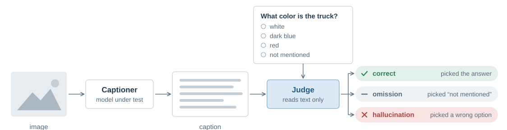

# CaptionExam

A hard, fine-grained benchmark for image captions. A text-only judge reads a model's caption, never the image, and answers multiple-choice questions about the image, so every question tells you whether the caption got a fact right, left it out, or got it wrong.

Dataset: [Ki-Seki/CaptionExam](https://huggingface.co/datasets/Ki-Seki/CaptionExam) on Hugging Face

<picture>
  <source media="(prefers-color-scheme: dark)" srcset="docs/how-it-works-dark.svg">
  
</picture>

## Quick start

```bash
pip install git+https://github.com/Ki-Seki/CaptionExam
captionexam download                      # benchmark -> ./data

# 1. Serve the judge (Phi-4, one GPU) on :8001
GPU=0 ./scripts/serve_judge.sh

# 2. Serve the model under test on :8000, e.g. with vLLM
vllm serve Qwen/Qwen3-VL-8B-Instruct --port 8000

# 3. Caption, judge, and print the leaderboard
captionexam caption --model Qwen/Qwen3-VL-8B-Instruct --name qwen3-vl-8b \
    --base-url http://localhost:8000/v1
captionexam judge --judge-base-url http://localhost:8001/v1
captionexam board
```

Any OpenAI-compatible endpoint works for the captioner and the judge; for a hosted model, pass `--base-url` and `--api-key`. `--prompt-file` swaps in your own caption prompt.

## Results

```text
results/
  captions/<name>.jsonl   one caption per image
  runs/<name>.jsonl       append-only verdicts, one per question
```

`captionexam board` recomputes the leaderboard from these files every time. Rerunning a command only fills gaps, and a regenerated caption is judged again. Commit `results/` with your report and anyone can recompute your scores.

## License

Code: [Apache-2.0](LICENSE). Dataset: see its [card](https://huggingface.co/datasets/Ki-Seki/CaptionExam).
